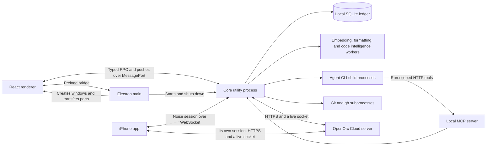
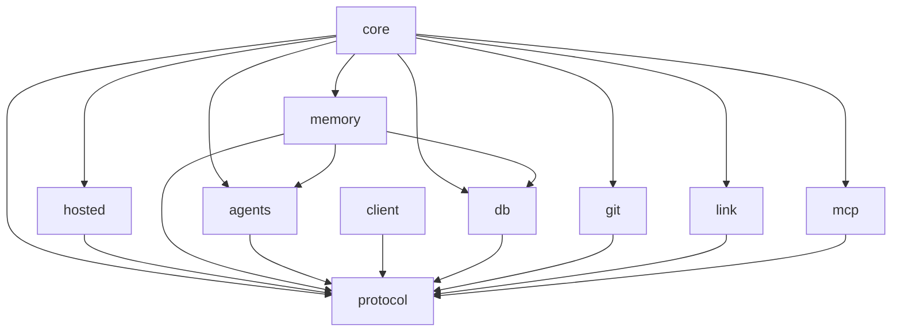

# Architecture

OpenOrc is a TypeScript workspace with an Electron desktop shell and an Expo iPhone app, both of which can also talk to OpenOrc Cloud. The application core runs in a utility process, separate from window management and rendering. Domain workflows use shared protocol types and can run in tests without launching Electron.

This guide describes the current structure. [PRODUCT.md](PRODUCT.md) describes intended behavior; [ROADMAP.md](ROADMAP.md) records current priorities. The roadmap also lists the next module and platform improvements.

## Process model

- **Main** owns windows, OS integration, terminal and browser panes, the device screen stream, and protected storage for every secret the core saves. It starts the utility process and hands MessagePorts to renderers.
- **Preload** exposes desktop capabilities to the sandboxed, context-isolated renderer.
- **Renderer** presents application state, sends RPC requests, and consumes frames and invalidations. Its client state comes from `@openorc/client`, which the phone shares: query tags, the transcript projection, and thread, model, and theme logic. TanStack Query holds requested data; streaming state is maintained separately for live transcripts.
- **Core utility process** hosts application workflows, persistence, provider processes, the MCP server, the phone listener, and the OpenOrc Cloud account. Embedding, Prettier formatting, and the TypeScript language service for the code editor run in worker threads. The Electron entry point supplies transport, protected-storage adapters, a terminal for interactive CLIs, and these workers to `OpenOrc.create`.
- **iPhone app** (`apps/mobile`) is an Expo React Native app. It pairs with the core through `@openorc/link`, and the core answers only the methods in `REMOTE_METHODS`, each with a guard and a shaped result in `packages/core/src/remote/policy.ts`.
- **OpenOrc Cloud** is a separate server, not in this repository. It holds accounts, organizations, cloud threads, team tasks, and chat, and runs a cloud thread's agent on a machine of its own. `@openorc/hosted` is the only code that speaks to it: one signed-in session per app with its HTTP calls and live socket, answered in the app's own protocol types. In the core, `PlaceRouter` is the first stop of every window call: calls about a thread the cloud holds go to it, and the cloud's rows join the lists. The phone mounts the same package with a session of its own, which the Mac it pairs with obtains for the person signed in there.

Entry points: [`main/index.ts`](apps/desktop/src/main/index.ts), [`preload/index.ts`](apps/desktop/src/preload/index.ts), [`core/index.ts`](apps/desktop/src/core/index.ts), [`renderer/src/main.tsx`](apps/desktop/src/renderer/src/main.tsx), and [`apps/mobile/index.ts`](apps/mobile/index.ts).

A release build has no OpenOrc Cloud address built in yet. A development or QA build reaches the server that `OPENORC_ACCOUNT_SERVER` names, and has no account or cloud features without one.

## Module responsibilities and seams

| Module     | Interface and hidden implementation                                                                                                                                                                                                                                                                                                                                                                                                                            |
| ---------- | -------------------------------------------------------------------------------------------------------------------------------------------------------------------------------------------------------------------------------------------------------------------------------------------------------------------------------------------------------------------------------------------------------------------------------------------------------------- |
| `protocol` | Shared schemas for domain records, RPC, agent events, and the methods a phone may call, plus the harness catalog. This is the common vocabulary; it does not own runtime workflows.                                                                                                                                                                                                                                                                            |
| `client`   | Client state shared by the desktop renderer and the phone: query cache tags, the transcript projection, the sidebar's day groups, and the turn, thread, model, and theme logic both draw from. It holds no transport.                                                                                                                                                                                                                                          |
| `core`     | `OpenOrc.create`, request handling, push transport, and shutdown compose application behavior. Workflow modules own runs, tasks, threads, workspaces, and integrations. `src/remote` owns phone access, and the account and hosted services mount `@openorc/hosted` with what only this Mac has.                                                                                                                                                               |
| `agents`   | Provider adapters normalize vendor protocols into `AgentEvent` and expose live controls through `RunHandle`. Provider-specific process and stream details stay here. Adapters start their CLI as a local child process, or through an `AgentHost` for a CLI that runs elsewhere.                                                                                                                                                                               |
| `db`       | `Db`, repositories, transactions, migrations, and ledger writing hide SQLite access. Vector retrieval is optional and degrades to full-text search when the extension is unavailable.                                                                                                                                                                                                                                                                          |
| `git`      | Git operations hide subprocess execution, worktree operations, snapshots, and change integration. GitHub pull requests (opening, listing, diffs and posting reviews) go through the user's `gh`; a review posted as the user's reviewer app uses GitHub's API with the app's own short-lived token. Repository hooks run only for the user's own commits, pushes and new worktrees, since other commands may run in a checkout of someone else's pull request. |
| `memory`   | Extraction, local embeddings, retrieval, and briefs use the persisted project history.                                                                                                                                                                                                                                                                                                                                                                         |
| `mcp`      | `startMcpServer` accepts a `McpHost` adapter. The server owns HTTP/tool transport; the host owns application behavior and authorization.                                                                                                                                                                                                                                                                                                                       |
| `link`     | The encrypted session between the desktop and a paired phone: Noise IK over a WebSocket, sealed records and messages, and the pairing code. Crypto is injected, so Node and React Native each supply their own.                                                                                                                                                                                                                                                |
| `hosted`   | OpenOrc Cloud as the app speaks to it: the session, every route and the live socket, the account, spaces, cloud threads, files, chat and tasks, answered in `protocol` types. `PlaceRouter` sends a window's calls about cloud threads there. It imports no Node, Electron, or React Native outside its test stand-in, so the core and the phone each hand in what only they have.                                                                             |

The declared package dependency direction is:

Low-level packages stay independent of the desktop and core workflows. The desktop depends on `core`, `client`, `agents`, `mcp`, and `protocol`; and the phone on `client`, `hosted`, `link`, and `protocol`. The diagram shows the dependencies each package declares; no automated rule checks imports against it.

## A turn through the system

1. The renderer sends an RPC request with a shared method and parameter shape. The utility-process entry validates the envelope, and the core validates and dispatches the method. A phone's request arrives over its link and passes the phone policy first.
2. The owning workflow resolves the thread or task, execution mode, workspace, and permissions before admitting work.
3. The run module captures the launch environment and starts the selected provider adapter through an `AgentHost`. The run receives a scoped URL for local MCP tools.
4. The adapter normalizes provider activity into events. The core persists events and coalesces renderer frames; application changes also invalidate query data. Phones receive frames shaped for them.
5. On completion or interruption, the owning workflow settles run and task state, workspace checkpoints, and any queued work. Persisted history supports reopening and transcript replay.

Execution location, authorization, and turn state are application invariants. Keep them in the core rather than reproducing decisions in renderer code, the phone, or provider adapters.

## Persistence and lifetime

SQLite uses the built-in `node:sqlite` driver. The desktop core owns its connection. Repository transactions use savepoints so nested operations compose. Migrations advance `PRAGMA user_version`; each migration is transactional and checks foreign keys. Existing migration history must remain compatible with persisted ledgers.

The app's profile also contains attachments, managed workspaces, and the encrypted files main keeps secrets in. A database backup alone does not include those files. Use a disposable profile for QA through `pnpm qa:onboarding`.

Phones from the App Store keep running older client code against a newer desktop. Add a new event type or result field behind a per-session capability in `packages/core/src/remote`, and never add fields to the link's hello, the pairing code, or message envelopes.

Shutdown ordering is explicit in `OpenOrc.close`: hosted files, the OpenOrc Cloud account, and phone access close first. Integration and workflow shutdown then precede agent process cleanup, device helpers, ledger flushing, MCP closure, and database closure. Modules that acquire processes, ports, timers, or subscriptions should expose a clear lifetime and release them on failure as well as normal completion.

## Changing the architecture

Depth means that callers get substantial behavior through a small interface. A useful extraction moves invariants and failure handling together; moving a switch into another file without hiding complexity does not improve depth.

- Keep composition in `OpenOrc`, but move domain policy into its owning workflow when it can be exercised through a smaller interface.
- Treat provider model discovery and revision-aware caching as a coherent candidate module, separate from live-run ownership.
- Keep transport adapters thin; domain tests should exercise the same interface used by callers with a fake transport or provider.
- Put agent-specific state, such as sessions, sign-ins, and CLI files, behind one per-agent interface that Claude Code, Codex, OpenCode, and Oh My Pi each implement, as `SessionSlot` in `agents` does.
- Test database upgrades using historical fixtures and the real current open/migration path.
- Preserve replay behavior when changing streaming events or transcript projection.

Refactor one seam at a time with existing behavior checks. `pnpm check:size` limits file and function size; see [code quality checks](docs/code-quality.md).
