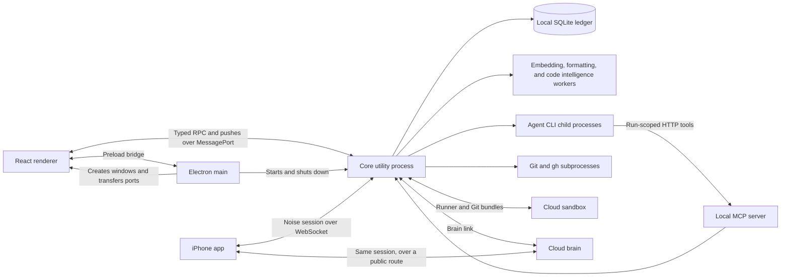
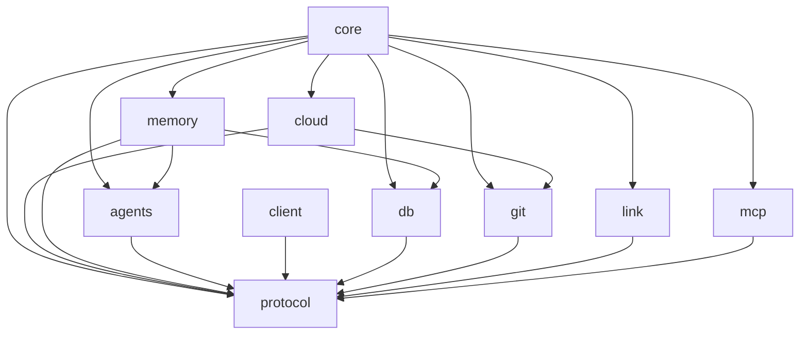

# Architecture

OpenOrc is a TypeScript workspace with an Electron desktop shell, an Expo iPhone app, and a headless cloud host. The application core runs in a utility process, separate from window management and rendering. Domain workflows use shared protocol types and can run in tests without launching Electron. The same core runs without Electron as the cloud brain.

This guide describes the current structure. [PRODUCT.md](PRODUCT.md) describes intended behavior; [ROADMAP.md](ROADMAP.md) records current priorities. The roadmap also lists the next module and platform improvements.

## Process model

- **Main** owns windows, OS integration, terminal and browser panes, the device screen stream, and protected storage for every secret the core saves. It starts the utility process and hands MessagePorts to renderers.
- **Preload** exposes desktop capabilities to the sandboxed, context-isolated renderer.
- **Renderer** presents application state, sends RPC requests, and consumes frames and invalidations. Its client state comes from `@openorc/client`, which the phone shares: query tags, the transcript projection, and thread, model, and theme logic. TanStack Query holds requested data; streaming state is maintained separately for live transcripts.
- **Core utility process** hosts application workflows, persistence, provider processes, the MCP server, the phone listener, and cloud threads. Embedding, Prettier formatting, and the TypeScript language service for the code editor run in worker threads. The Electron entry point supplies transport, protected-storage adapters, a terminal for interactive CLIs, and these workers to `OpenOrc.create`.
- **iPhone app** (`apps/mobile`) is an Expo React Native app. It pairs with the core through `@openorc/link`, and the core answers only the methods in `REMOTE_METHODS`, each with a guard and a shaped result in `packages/core/src/remote/policy.ts`.
- **Cloud sandboxes** run a cloud thread's agent. The core uploads the runner from `packages/cloud/src/runner` into a Vercel Sandbox or an Agent37 instance, starts agents through it, and moves the checkout both ways as Git bundles.
- **Cloud brain** (`apps/brain`) runs the core headless in a Linux sandbox, so paired phones keep working while the computer sleeps. Each thread has one owner, the desktop or the brain. The desktop's `BrainRouter` sends a window's calls about brain threads to the brain and merges both hosts' lists. Phones dial the brain themselves, through the TLS proxy in front of its sandbox; on Vercel, a small door function deployed beside it wakes a sleeping brain for a paired phone.

Entry points: [`main/index.ts`](apps/desktop/src/main/index.ts), [`preload/index.ts`](apps/desktop/src/preload/index.ts), [`core/index.ts`](apps/desktop/src/core/index.ts), [`renderer/src/main.tsx`](apps/desktop/src/renderer/src/main.tsx), [`apps/mobile/index.ts`](apps/mobile/index.ts), and [`apps/brain/src/main.ts`](apps/brain/src/main.ts).

Every build offers cloud threads and the brain. A packaged app carries the brain's archive and its door function in its resources folder, under `brain/`, which `electron-builder.yml` copies from `apps/brain/dist`. Main passes that folder to the core as `OPENORC_BRAIN_DIR`. A build run from the repository uses `apps/brain/dist` directly. The release workflow builds the brain once on Linux, and every platform's package carries that same brain.

## Module responsibilities and seams

| Module     | Interface and hidden implementation                                                                                                                                                                                                                                                                                                                                                                                                                            |
| ---------- | -------------------------------------------------------------------------------------------------------------------------------------------------------------------------------------------------------------------------------------------------------------------------------------------------------------------------------------------------------------------------------------------------------------------------------------------------------------- |
| `protocol` | Shared schemas for domain records, RPC, agent events, and the methods a phone may call, plus the harness catalog. This is the common vocabulary; it does not own runtime workflows.                                                                                                                                                                                                                                                                            |
| `client`   | Client state shared by the desktop renderer and the phone: query cache tags, the transcript projection, the sidebar's day groups, and the turn, thread, model, and theme logic both draw from. It holds no transport.                                                                                                                                                                                                                                          |
| `core`     | `OpenOrc.create`, request handling, push transport, and shutdown compose application behavior. Workflow modules own runs, tasks, threads, workspaces, and integrations. `src/remote` owns phone access, and the cloud services own sandboxes, moves between hosts, and the brain.                                                                                                                                                                              |
| `agents`   | Provider adapters normalize vendor protocols into `AgentEvent` and expose live controls through `RunHandle`. Provider-specific process and stream details stay here. Adapters start their CLI through an `AgentHost`, which is a local child process or a cloud sandbox's runner.                                                                                                                                                                              |
| `db`       | `Db`, repositories, transactions, migrations, and ledger writing hide SQLite access. Vector retrieval is optional and degrades to full-text search when the extension is unavailable.                                                                                                                                                                                                                                                                          |
| `git`      | Git operations hide subprocess execution, worktree operations, snapshots, and change integration. GitHub pull requests (opening, listing, diffs and posting reviews) go through the user's `gh`; a review posted as the user's reviewer app uses GitHub's API with the app's own short-lived token. Repository hooks run only for the user's own commits, pushes and new worktrees, since other commands may run in a checkout of someone else's pull request. |
| `memory`   | Extraction, local embeddings, retrieval, and briefs use the persisted project history.                                                                                                                                                                                                                                                                                                                                                                         |
| `mcp`      | `startMcpServer` accepts a `McpHost` adapter. The server owns HTTP/tool transport; the host owns application behavior and authorization.                                                                                                                                                                                                                                                                                                                       |
| `link`     | The encrypted session between the desktop and a paired phone: Noise IK over a WebSocket, sealed records and messages, and the pairing code. Crypto is injected, so Node and React Native each supply their own.                                                                                                                                                                                                                                                |
| `cloud`    | The `Sandbox` interface with Vercel Sandbox, Agent37, and local stand-in providers; the runner that keeps agent processes alive inside a sandbox; Git bundle sync between a sandbox and the desktop; and the brain's machine, wire format, and sealed secrets.                                                                                                                                                                                                 |

The declared package dependency direction is:

Low-level packages stay independent of the desktop and core workflows. The desktop depends on `core`, `client`, `agents`, `mcp`, and `protocol`; the phone on `client`, `link`, and `protocol`; the brain on `core`, `cloud`, `db`, `git`, `link`, and `protocol`. The diagram shows the dependencies each package declares; no automated rule checks imports against it. The cloud runner also bundles the file-boundary hook from `mcp`, which `cloud` declares as a development dependency.

## A turn through the system

1. The renderer sends an RPC request with a shared method and parameter shape. The utility-process entry validates the envelope, and the core validates and dispatches the method. A phone's request arrives over its link and passes the phone policy first.
2. The owning workflow resolves the thread or task, execution mode, workspace, and permissions before admitting work.
3. The run module captures the launch environment and starts the selected provider adapter through an `AgentHost`. The run receives a scoped URL for local MCP tools.
4. The adapter normalizes provider activity into events. The core persists events and coalesces renderer frames; application changes also invalidate query data. Phones receive frames shaped for them.
5. On completion or interruption, the owning workflow settles run and task state, workspace checkpoints, and any queued work. Persisted history supports reopening and transcript replay.

Execution location, authorization, and turn state are application invariants. Keep them in the core rather than reproducing decisions in renderer code, the phone, or provider adapters.

## Persistence and lifetime

SQLite uses the built-in `node:sqlite` driver. The desktop core owns its connection. Repository transactions use savepoints so nested operations compose. Migrations advance `PRAGMA user_version`; each migration is transactional and checks foreign keys. Existing migration history must remain compatible with persisted ledgers.

The app's profile also contains attachments, managed workspaces, and the encrypted files main keeps secrets in. A database backup alone does not include those files. Use a disposable profile for QA through `pnpm qa:onboarding`.

Phones from the App Store keep running older client code against a newer desktop. Add a new event type or result field behind a per-session capability in `packages/core/src/remote`, and never add fields to the link's hello, the pairing code, or message envelopes.

Shutdown ordering is explicit in `OpenOrc.close`: cloud moves, brain routing, and phone access close first. Integration and workflow shutdown then precede agent process cleanup, cloud and device helpers, ledger flushing, MCP closure, and database closure. Modules that acquire processes, ports, timers, or subscriptions should expose a clear lifetime and release them on failure as well as normal completion.

## Changing the architecture

Depth means that callers get substantial behavior through a small interface. A useful extraction moves invariants and failure handling together; moving a switch into another file without hiding complexity does not improve depth.

- Keep composition in `OpenOrc`, but move domain policy into its owning workflow when it can be exercised through a smaller interface.
- Treat provider model discovery and revision-aware caching as a coherent candidate module, separate from live-run ownership.
- Keep transport adapters thin; domain tests should exercise the same interface used by callers with a fake transport or provider.
- Put agent-specific state, such as sessions, sign-ins, and CLI files, behind one per-agent interface that Claude Code, Codex, OpenCode, and Oh My Pi each implement, as `SessionSlot` in `agents` and `CloudSignIn` in `core` do for cloud threads.
- Test database upgrades using historical fixtures and the real current open/migration path.
- Preserve replay behavior when changing streaming events or transcript projection.

Refactor one seam at a time with existing behavior checks. `pnpm check:size` limits file and function size; see [code quality checks](docs/code-quality.md).
