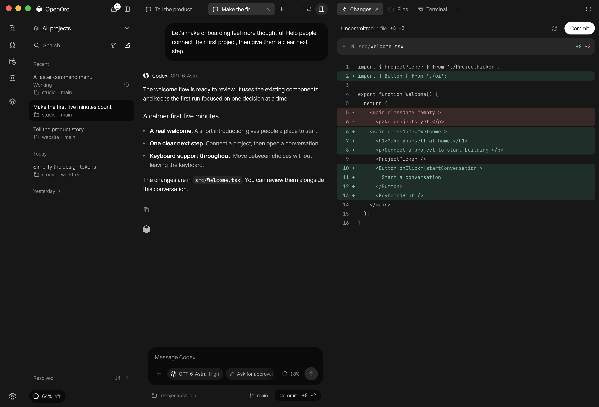
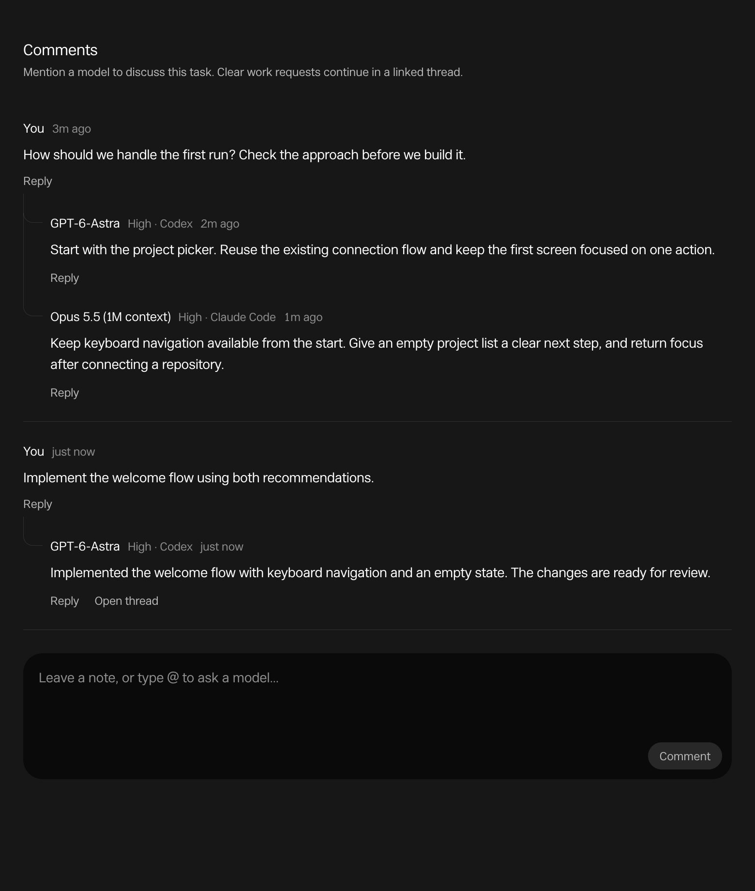

<p align="center">
  
</p>

<h1 align="center">OpenOrc</h1>

<p align="center"><strong>Your coding agents, working together.</strong></p>

<p align="center">
  <a href="#why-openorc">Why OpenOrc</a> ·
  <a href="#run-from-source">Get started</a> ·
  <a href="docs/README.md">Documentation</a> ·
  <a href="CONTRIBUTING.md">Contribute</a>
</p>

OpenOrc is a **desktop workspace for Codex, Claude Code, and OpenCode**. Bring your existing agents and accounts to plan work, build features, and review changes in one place.

Work with Codex, Claude Code, and OpenCode in one workspace. Agents can share context between threads and carry project decisions into the next task, so you spend less time repeating yourself.

## Why OpenOrc

Choose an agent for each job while keeping the work connected through shared conversations, tasks, and project memory.

### Share context across threads and providers

Let a Claude Code thread building your interface ask a Codex thread about an API decision. Agents can find, read, and message other OpenOrc threads in the same project, and start a helper thread in the same folder when you ask, saving you from copying context between conversations.

An idle thread starts a new turn to read a message; a busy thread receives it during its current turn. Agents can send up to 20 messages in a row across threads, and an exchange ends when one agent doesn't reply. After 20, a person has to write before they can send more.

When an agent hands work to subagents of its own, such as Claude Code subagents and workflows, Codex collaboration agents, or OpenCode child sessions, each one becomes a read-only thread under the thread that started it, so you can follow what it did.

### Keep what your project learns

Save decisions, lessons, and useful commands as project memory. An agent can retrieve that knowledge in a later task, even if it uses a different provider.

Memory is optional. Turn it off or configure automatic extraction in Settings.

### Turn ideas into reviewed changes

Capture an idea as a task, ask multiple models for input, then start implementation when you're ready. Work in your local checkout or an isolated worktree, and review changes beside the conversation. The same panel opens the project's files to read, edit, or have explained in plain English, along with a terminal, a browser preview, and iOS Simulators or Android Emulators that you and your agents can drive.



_Screenshots use sample projects and conversations._

<details>
<summary>See a task discussion with Codex and Claude Code</summary>

Get a second perspective before you build. Request implementation when you're ready, then follow the work in a linked thread.



</details>

### Keep working from your phone

Pair the OpenOrc iPhone app with the desktop in **Settings → Phone**. The phone shows your threads live, answers approvals and questions, sends and steers messages, starts new threads, and commits, pushes, and opens pull requests. It connects straight to the desktop over your local network or Tailscale, encrypted end to end, with no OpenOrc server in between.

## Project status

OpenOrc was initially built in private and is now open source. It is in active beta development.

| Platform             | Status                                                                                                                                                                                                                     |
| -------------------- | -------------------------------------------------------------------------------------------------------------------------------------------------------------------------------------------------------------------------- |
| macOS, Apple Silicon | Supported. CI runs the full test suite here.                                                                                                                                                                               |
| macOS, Intel         | Released, but not fully validated. Release builds pass the packaged startup and update checks; the test suite runs only on Apple Silicon.                                                                                  |
| Windows x64          | Released, but not fully validated. Release builds are installed and smoke-tested; the test suite does not run on Windows. A beta installer can be unsigned; its release notes say so.                                      |
| Linux x64            | Released, but not fully validated. Release builds ship as an rpm, a deb and an AppImage; the deb and AppImage are installed and smoke-tested, and CI runs the test suite on Ubuntu. Installs do not update themselves yet. |

The iPhone app in `apps/mobile` is built and tested against the desktop app on a Mac. Cloud threads, which run in a sandbox on your own Vercel or Agent37 account, ship in release builds, and each release carries the cloud brain it installs there.

See the [release guide](docs/desktop-updates.md) and [roadmap](ROADMAP.md).

On Linux, install the rpm on Fedora or openSUSE (`sudo dnf install ./OpenOrc-….rpm`) and the deb on Debian or Ubuntu (`sudo apt install ./OpenOrc-….deb`). Both add OpenOrc to your applications and an `openorc` command. The AppImage runs anywhere else; like other AppImages, it needs FUSE 2 (`fuse-libs` on Fedora, `libfuse2t64` on Ubuntu). Linux packages are not code-signed, so check your download against the release's `SHA256SUMS.txt`.

## Run from source

You'll need **Node.js 24**, **pnpm 11.21.0**, and Git on your shell's PATH. These Node and pnpm versions are recorded in `.node-version` and `package.json`. On Linux, the terminal's native module compiles during installation, so you also need a C++ compiler, make and Python 3 (`sudo dnf install gcc-c++ make python3` on Fedora, `sudo apt install build-essential python3` on Debian and Ubuntu). Install and sign in to at least one supported agent CLI. The GitHub CLI (`gh`) is optional and enables pull request workflows.

| Agent       | Setup                                                                                      |
| ----------- | ------------------------------------------------------------------------------------------ |
| Codex       | [Install Codex CLI](https://developers.openai.com/codex/cli), then run `codex login`       |
| Claude Code | [Install Claude Code](https://code.claude.com/docs/en/setup), then run `claude auth login` |
| OpenCode    | [Install OpenCode](https://opencode.ai/docs/), then run `opencode auth login`              |

Use your existing provider accounts. No separate OpenOrc account is required.

From a clone of this repository:

```sh
pnpm install --frozen-lockfile
pnpm dev
```

Start a thread with **⌘N** (**Ctrl+N** on Windows and Linux). Its heading asks what to work on in the current project. Click the project name to choose another, or choose **Add project** at the end of that list to add a folder. **Workspace** holds conversations that belong to no project.

The sidebar lists threads by when they last worked: **Recent** for the last three hours, then **Today** and **Yesterday**. Pinned and snoozed threads keep their own groups. Other threads quiet since before yesterday, and the ones you resolve, collect in the **Resolved** drawer at the foot of the sidebar. Drag a thread there to resolve it, or out to reopen it. The buttons beside your usage at the bottom open Tasks, Pull requests, Schedules, and Settings, and switch the list to your Orclings.

Tasks save to the backlog until you start them. Choose a local checkout or isolated worktree in the task's **Execution settings**. New tasks default to **Settings → General → Workspace**; tasks created from a conversation use that thread's location. Changing the location after work starts moves the task's conversation.

A task's changes appear in its conversation's **Changes** panel, where you can comment on lines, commit, push, or open a pull request. See [task behavior](docs/task-editor.md) and the [product model](PRODUCT.md).

For a disposable development profile that does not use your regular OpenOrc data:

```sh
pnpm qa:onboarding --dev
```

See [CONTRIBUTING.md](CONTRIBUTING.md) for native dependency troubleshooting, verification, and focused development commands.

## Data and credentials

Conversations, task records, and project memory are stored on your machine. Each agent's requests go to its own provider, and a small model from the conversation's own agent names the conversation and writes the code explanations you ask for. Memory is off until you turn it on. While it is on, the agent that ran each finished run summarizes it, unless you choose one provider for every run, and the first search by meaning downloads a 91 MB embedding model from Hugging Face, each file checked against a pinned SHA-256. Installed macOS and Windows releases check GitHub Releases for newer stable and beta versions, without an installation identifier; Settings → General turns automatic checks off. **Device support** in Settings → Devices installs its two pinned helper tools with your own npm into the data folder when it first needs them. [Network connections](https://openorc.app/docs/network/) lists every connection the app makes.

Phone access is off until you turn on **Allow paired phones** in **Settings → Phone**. While it is on, the desktop listens on port 47820, or another free port when that one is taken, on every network interface. It drops connections from outside private networks, link-local addresses, and Tailscale's address range before reading them, and paired phones talk to it over a Noise session encrypted end to end. Phone notifications need an Apple push key added in the same section; the desktop then seals each alert for one phone and sends it through Apple's Push Notification service.

Cloud threads run in a sandbox on the Vercel or Agent37 account you connect in **Settings → Cloud**. Code moves between the desktop and the sandbox as Git bundles while the thread works. Agents there sign in with a token each Claude account makes with `claude setup-token`, and with a Codex or OpenCode sign-in made for the cloud or a key copied from this computer after you approve. To offer those keys, Settings → Cloud reads an OpenAI API key from Codex's `auth.json` and the provider keys OpenCode keeps; ChatGPT and Claude logins are never copied. On Vercel, when the team's plan allows it, the sandbox firewall adds the sign-ins to the agents' requests on their way out, so the sandbox holds only stand-ins; Agent37 sandboxes hold the sign-ins themselves. The optional cloud brain is a headless copy of OpenOrc in the same account. It keeps copies of the projects you choose, shares memory and tasks with the desktop, and answers paired phones while the computer sleeps.

The desktop stores its SQLite ledger, attachments, images tools return, and managed workspaces in the application data directory: `~/Library/Application Support/OpenOrc` on macOS, `%APPDATA%\OpenOrc` on Windows, and `~/.config/OpenOrc` on Linux. `OPENORC_USER_DATA` selects a different profile. Treat this directory as private: it can contain prompts, source snippets, terminal output, and project history. Native provider output goes to a debug log in `logs/provider` there, kept for 14 days or 512 MB; deleting a thread does not remove its lines from that log before they expire. Redaction of the ledger, its search index, run results, memories, and logs is a best-effort filter, not a guarantee that all sensitive content is removed. Plans and task comments are stored as written because agents receive them later. The ledger also records each paired phone with its push token, and each cloud sandbox.

Agent execution uses the installed CLIs and their existing login flows. The Claude usage display asks the installed Claude Code CLI for its plan usage; OpenOrc never reads the credential Claude Code stores. OpenOrc's own secrets use Electron's OS-backed protected storage: direct Slack credentials, the optional memory-extraction API key, the reviewer app's key, the desktop's key for paired phones, the Apple push key, and the cloud connections and sign-ins. See [credential storage](docs/credential-storage.md) for recovery and backup considerations.

## Develop and verify

```sh
pnpm typecheck
pnpm lint
pnpm format:check
pnpm check:size
pnpm test
pnpm build
```

CI runs these checks. [Code quality checks](docs/code-quality.md) explains the lint, formatting, and size rules, and [CONTRIBUTING.md](CONTRIBUTING.md#verification) lists the additional script tests. Live-provider smoke tests are separate and can execute agent work using your account; see [CONTRIBUTING.md](CONTRIBUTING.md) before running them.

## Repository guide

| Location            | Responsibility                                                                    |
| ------------------- | --------------------------------------------------------------------------------- |
| `apps/desktop`      | Electron shell, core utility-process entry point, and React interface             |
| `apps/mobile`       | Expo iPhone app that pairs with the desktop                                       |
| `apps/brain`        | The cloud brain: the core running headless in a Linux sandbox                     |
| `apps/website`      | Astro website, docs, and HTML/CSS product demos                                   |
| `packages/core`     | Application workflows, validated RPC handling, phone access, and cloud threads    |
| `packages/protocol` | Shared domain records, events, harness catalog, and RPC schemas                   |
| `packages/client`   | Client state shared by the desktop renderer and the phone                         |
| `packages/agents`   | Vendor CLI adapters and normalized agent events                                   |
| `packages/db`       | SQLite migrations, repositories, ledger, and retrieval storage                    |
| `packages/git`      | Git commands, worktrees, snapshots, and change integration                        |
| `packages/memory`   | Embeddings, extraction, retrieval, and project briefs                             |
| `packages/mcp`      | Run-scoped local MCP server and host interface                                    |
| `packages/link`     | Encrypted session and pairing code between the desktop and a phone                |
| `packages/cloud`    | Cloud sandboxes, the runner inside them, Git bundle sync, and the brain's machine |
| `scripts`           | Reproducible QA fixtures and smoke checks                                         |

Read the [architecture guide](ARCHITECTURE.md) for the process model and module seams, [interface conventions](docs/design-system.md) for visual conventions, and [the documentation index](docs/README.md) for feature references. The [roadmap](ROADMAP.md) records current priorities.

Generated previews and test screenshots belong in ignored `output/` or temporary directories. Curated README images are tracked with their [capture record](docs/images/readme/README.md). Keep runtime artwork tracked, along with any editable source it has. The Rive mascot is included only as its runtime file; see the [mascot record](assets/mascot/README.md).

## License

OpenOrc's original code and documentation are licensed under the [Apache License, Version 2.0](LICENSE). See [NOTICE](NOTICE) for project attribution. Third-party dependencies and separately licensed assets retain their respective licenses and notices.

Provider marks retain separate rights. See [third-party notices](THIRD_PARTY_NOTICES.md) and [artwork provenance](docs/artwork-provenance.md) for attribution, asset sources, and permission limits.

The license does not grant trademark rights to the OpenOrc name or branding, except for the descriptive uses permitted by the license.
